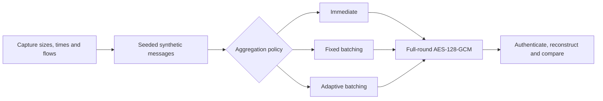

# AdaptAES

AdaptAES is a college research experiment in **traffic-aware authenticated
aggregation**. It asks whether grouping messages according to their sizes and
arrival patterns can reduce record overhead while respecting a queueing budget.

Every current policy uses full-round AES-128-GCM with a full 128-bit authentication
tag. Adaptation changes buffering and record boundaries. The original 4/6/8/10-round
experiment remains available as an **insecure historical comparison**.

Start with the [five-minute professor guide](docs/professor_guide.md).

## The experiment



| Policy | Behavior |
|---|---|
| Immediate | One authenticated record per message |
| Fixed | Batch within a flow until a count, byte limit, or deadline is reached |
| Adaptive | Use size and the previous per-flow arrival gap to choose a batch target; bypass buffering for large or sparse messages |

Defaults are an eight-message target, a 16 KiB batch limit, a 1 ms maximum
modeled queueing delay, and a 512-byte small-message threshold. A message larger
than the batch limit is sent immediately as a singleton, within the 64 KiB record-body limit.

## Results and interpretation


The recorded run covers 5,000 payload rows from each of six captures. Summing the
capture summaries, fixed batching reduces record overhead by about 24%; the
adaptive heuristic reduces it by about 3.7%. Adaptive batching uses more CPU
than immediate encryption on these captures. This policy is a starting heuristic,
not a demonstrated universal performance improvement.


The controlled examples explain the mechanism. Batching helps a burst of small
messages; sparse messages gain nothing from waiting. These examples are synthetic
and are reported separately from capture-derived results.

All modes use the same native cryptographic implementation. Measured processing
cost includes scheduling, framing, encryption, and decryption. Queueing delay is
simulated from trace timestamps and reported separately from CPU and wall time.
This experiment does not claim an end-to-end network latency guarantee.

## Run the classroom demo

Use Python 3.11+ and uv:

```bash
uv sync --frozen --extra plots
uv run python -m unittest discover -s scripts -v
uv run python scripts/generate_aggregation_graphs.py
```

The graphs regenerate from checked-in summaries. To rerun the experiment:

```bash
uv run python scripts/benchmark_aggregation.py --limit 5000 --repeats 11
uv run python scripts/generate_aggregation_graphs.py
```

The checked-in extracted CSVs are enough. No raw captures, generated payload
binaries, external service, or network endpoint is needed. Timing values vary
with the machine and load; record counts and modeled waiting times are deterministic.

## Files to show the professor

| File | Purpose |
|---|---|
| [Professor guide](docs/professor_guide.md) | Research question, graphs, methodology, limitations and viva explanation |
| `scripts/authenticated_records.py` | AES-GCM records, authenticated framing and ordered delivery |
| `scripts/aggregate_records.py` | Immediate, fixed and adaptive per-flow scheduling |
| `scripts/benchmark_aggregation.py` | Seeded trace replay, measured timings and modeled queueing |
| `results/aggregation/summary.csv` | All policy and workload results |
| `results/aggregation/methodology.json` | Configuration, source hashes and environment |

The record format is an in-memory experiment between cooperating endpoints.
Each trial generates a fresh key and uses increasing 96-bit nonces. It authenticates
flow metadata and rejects tampering, replay, and record reordering. Key exchange,
session persistence, transport retransmission, and production deployment are outside its scope.

## Original reduced-round experiment

The [original project report](docs/AdaptAES_full_project_report.md), AES scripts,
and results under `results/classroom/`, `results/analysis/`, and `results/comparison/`
remain for comparison. Reduced-round configurations are vulnerable to cryptanalysis.
Their independent-block message encryption also lacks authentication. Avalanche
and entropy scores do not establish security, and their timing results should not
be compared directly with the native AES-GCM implementation as an algorithm speedup.
