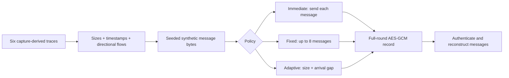
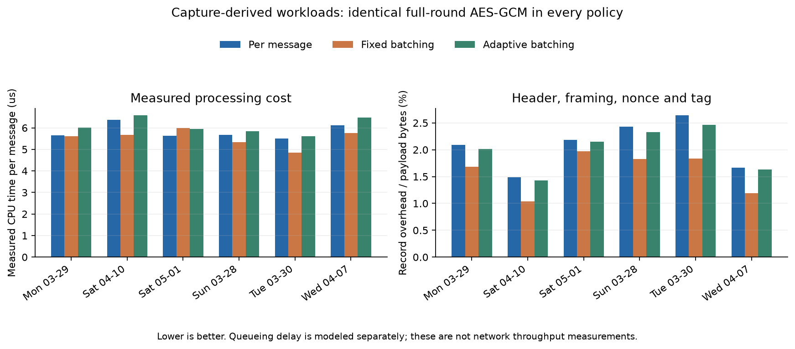
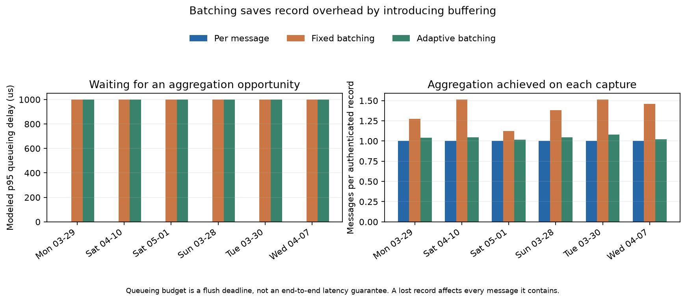
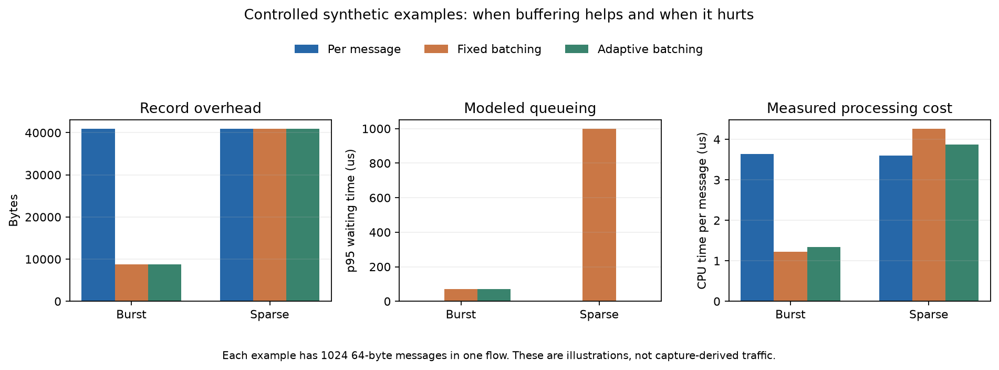

# AdaptAES: a five-minute professor walkthrough

The research question is whether traffic-aware message aggregation can reduce
processing and record overhead under a fixed queueing budget. All three policies
use the same full-round AES-128-GCM implementation and 128-bit authentication tags.

The original idea changed AES rounds by packet size. It is retained as an insecure
comparison. This pivot moves adaptation into record scheduling, where its costs
and benefits can be measured without weakening the cipher.

## 1. Explain what adapts



Messages can share a record only within the same directional flow. Here a flow is
identified by protocol, source/destination addresses, and source/destination ports.
The benchmark maps those identities to numeric IDs; it does not publish addresses
in its result files.

A captured transport payload is treated as one synthetic message. This is a
workload model, not TCP application-message reconstruction or live packet encryption.

| Policy | What determines when a record is released? |
|---|---|
| Immediate | The message's arrival time |
| Fixed | Eight messages, 16 KiB of framed data, or the oldest message's 1 ms deadline |
| Adaptive | The same bounds, with a target based on size and the previous per-flow arrival gap |

For adaptive mode, messages above 512 bytes bypass waiting. Smaller messages use
`min(8, 1 + floor(queue_budget / max(previous_gap, 1 ns)))` as the target. New flows
start with a target of eight. These are documented heuristic choices, not learned
or globally optimal thresholds. A new arrival never extends an existing deadline.

Oversized messages bypass aggregation as singletons, up to the record format's
64 KiB body limit. At trace end, outstanding batches still wait for their deadline;
knowing that an offline file ended does not create a free early flush.

## 2. Show the security boundary

```text
Authenticated outer header: version [4 B] | flow ID [4 B] | sequence/nonce [12 B]
Encrypted body:             length [4 B] | message | length [4 B] | message ...
Authentication tag:        full 16 B
```

The complete outer header is authenticated as associated data. Length prefixes
are inside the authenticated ciphertext. The receiver verifies the tag before
parsing or returning plaintext, checks the expected flow and sequence, and only
then releases reconstructed messages. Missing, duplicate, or reordered records
are rejected in this ordered-stream experiment.

Each trial creates a fresh random AES-128 key. A monotonically increasing 96-bit
counter supplies nonces within that trial. Key generation is outside timing;
framing, nonce construction and tag checks are inside timing. The codec deliberately
has no API for importing/reusing keys across sessions.

This prototype has no key exchange, persisted session state, or retransmission
layer. A missing record stalls ordered reception until it is supplied. A larger
record also means more messages are affected together by loss. It is not a claim
that a complete deployed network protocol has been proven secure.

## 3. Explain the capture-derived results



The sample is the first 5,000 nonempty payload rows of each capture, stably sorted
by timestamp. Its 30,000 messages contain 59,946,242 payload bytes. This is a
chronological-prefix experiment, not the random sample used in the older AES study.

| Policy | Records | Record overhead bytes | Processing CPU per message |
|---|---:|---:|---:|
| Immediate | 30,000 | 1,200,000 | 5.83 us |
| Fixed | 22,024 | 912,864 | 5.54 us |
| Adaptive | 28,778 | 1,156,008 | 6.08 us |

Counts and bytes are summed across captures. CPU per message is the sum of the
six median processing CPU times divided by 30,000. The sample gives equal weight
to each capture, rather than weighting by the full capture's packet count.

Fixed batching saves about 24% of record overhead. Including payload bytes, that
is about 0.47% fewer total record bytes. Adaptive batching saves about 3.7% of
overhead and uses more CPU than immediate encryption here. The defensible result
is that the tradeoff depends on traffic and policy; this heuristic does not win
on every workload.

The record overhead formula is `36 * records + 4 * messages`: a 20-byte header
and a 16-byte tag per record, plus a four-byte length per message. Transport
headers are excluded. Small-message workloads have more to gain from amortizing
these fixed costs than workloads dominated by large messages.



Both batching policies stay within the configured 1 ms modeled waiting budget.
Their p95 waiting time reaches that budget in every capture. This matters when
explaining the overhead saving: it comes with buffering, not for free.

Queueing delay means record release time minus message arrival time in the trace.
It does not include a simulated CPU backlog, network time, retransmission, or peer
processing. Measured CPU/wall time and modeled waiting are separate outputs.

## 4. Use controlled examples to explain why



Both examples contain 1,024 64-byte messages in one flow. The burst has 10 us
between arrivals; the sparse case has 5 ms between arrivals. They are illustrations,
not additional HIKARI captures.

In the burst, fixed and adaptive batching both produce 128 records and reduce
record overhead from 40,960 to 8,704 bytes. Their modeled p95 waiting time is
70 us. In sparse traffic, fixed batching waits 1 ms without reducing record count.
Adaptive mode bypasses waiting after observing the first sparse gap; its p95
waiting time is zero, although the first message still waits up to 1 ms.

These examples show an opportunity for adaptation without claiming that the
current threshold choices are optimal. A sensible follow-up is to select thresholds
on one group of flows and evaluate them on held-out flows or captures.

## 5. Reproduce and interpret the measurement

```bash
uv sync --frozen --extra plots
uv run python -m unittest discover -s scripts -v
uv run python scripts/generate_aggregation_graphs.py
```

These commands regenerate the graphs from recorded results. To run new measurements:

```bash
uv run python scripts/benchmark_aggregation.py --limit 5000 --repeats 11
uv run python scripts/generate_aggregation_graphs.py
```

Each workload has one warm-up per policy and eleven timed repetitions in rotating
policy order. Every trial uses a fresh key and verifies message conservation and
exact authenticated reconstruction. Processing time includes scheduling, framing,
encryption and decryption. Key generation, synthetic-data generation, source-file
hashing and correctness comparisons are excluded.

The CSV includes per-stage CPU and wall times, processing throughput, record
counts, overhead, flush reasons, p50/p95/p99/max modeled waiting, and the maximum
messages affected by losing one record. The JSON records source hashes, seed,
configuration, Python/platform and cryptography versions. Numeric flow IDs stay
local to each capture.

To explore a different waiting budget, write a separate result directory:

```bash
uv run python scripts/benchmark_aggregation.py \
  --max-delay-us 100 --out-dir results/aggregation-100us
uv run python scripts/generate_aggregation_graphs.py --results-dir results/aggregation-100us
```

The recorded run used Python 3.14.8 and cryptography 50.0.2. Native AES-GCM is used
for every policy. A speed difference from the old pure-Python AES scripts would
mix implementation and algorithm changes, so it is not used as evidence for
aggregation.

The closing viva statement can be:

> We preserved full-round authenticated encryption and moved adaptation to
> per-flow record scheduling. Batching reduced overhead on these traces, but
> introduced waiting. Our adaptive heuristic helped the controlled sparse/burst
> cases and did not beat immediate encryption's CPU cost on the captures.

## Research context and historical comparison

Dynamic record sizing already exists. The college contribution is the explicit
policy, reproducible trace evaluation, and measured tradeoff, not a new cipher
or a claim to have invented batching. See [s2n-tls record sizing](https://aws.github.io/s2n-tls/usage-guide/ch08-record-sizes.html)
and [NIST's AES-GCM specification](https://csrc.nist.gov/pubs/sp/800/38/d/final).

The [original reduced-round report](AdaptAES_full_project_report.md) and
`results/comparison/round_comparison.png` retain the original experiment.
Reduced rounds and unauthenticated independent-block encryption are insecure
controls. Similar entropy or avalanche scores do not repair those weaknesses.
